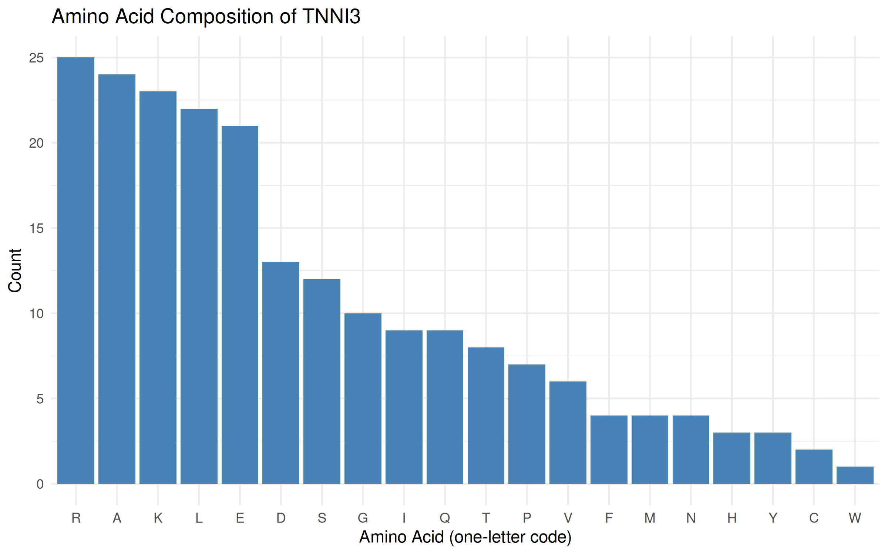
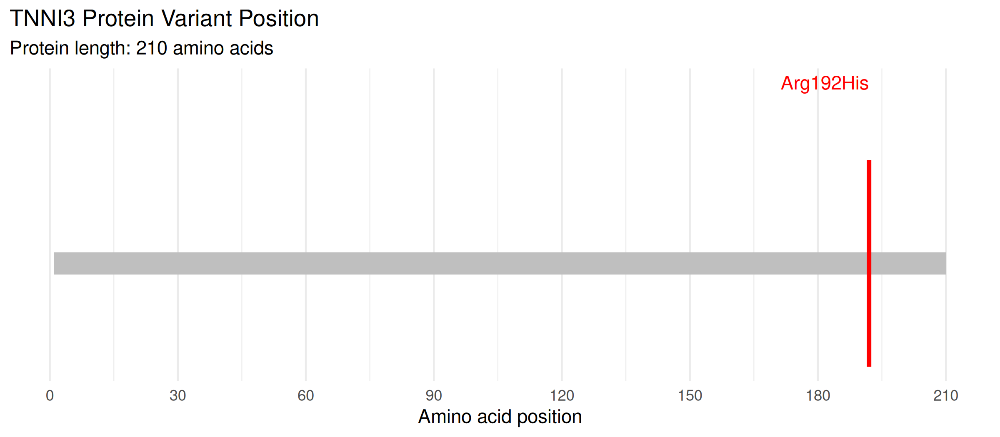

# TNNI3 Variant Analysis: Molecular Mechanisms of Muscle Contractility

### 1. Assignment Information:

- **Assignment number:** 15
- **Gene symbol:** TNNI3
- **NCBI Gene ID:** 7137
- **Organism:** *Homo sapiens*
- **Assigned transcript:** NM_000363.5
- **RefSeq protein accession:** NP_000354.4
- **DNA variant:** c.575G>A
- **Protein variant:** p.Arg192His (p.R192H)
- **ClinVar Variation ID:** 12424
- **Variant type:** Missense

### 2. Research Question:

What does the TNNI3 gene encode, and how might the assigned p.Arg192His variant affect the regulation of cardiac muscle contraction and relaxation? 

This project uses NCBI sequence records, amino-acid composition analysis, and ClinVar evidence to characterize the assigned variant and evaluate what is known and uncertain about its possible functional effects.

### 3. Methods:

**Method 1 - Set up the R project**

The project was organized into `data/`, `results/`, and `figures/` folders, with `analysis.R` in the root directory.

Install the required packages once:

```r
install.packages(c("rentrez", "ggplot2"))
```

Load the packages at the beginning of a new R session:

```r
library(rentrez)
library(ggplot2)
```

Set the assigned identifiers and create the output directories:

```r
gene_symbol <- "TNNI3"
transcript_accession <- "NM_000363.5"
clinvar_id <- "12424"
variant_protein <- "p.Arg192His"

for (x in c("data", "results", "figures")) {
  dir.create(x, showWarnings = FALSE)
}
```

**Method 2 - Retrieve the NCBI Gene record**

The human TNNI3 record was searched in NCBI Gene using the gene symbol and human taxonomy ID. The record was checked to confirm the exact gene.

```r
hits <- entrez_search(
  db = "gene",
  term = paste0(
    gene_symbol,
    "[Gene Name] AND txid9606[Organism]"
  ),
  retmax = 20
)

if (length(hits$ids) == 0) {
  stop("Gene not found")
}

gene_id <- NA_character_

for (id in hits$ids) {
  rec <- entrez_summary(db = "gene", id = id)
  if (toupper(rec$name) == toupper(gene_symbol)) {
    gene_id <- id
    gene_info <- rec
    break
  }
}

if (is.na(gene_id)) {
  stop("Exact human gene not found")
}

print(gene_info)
```

The Gene ID, official name, chromosome, and normal biological role were recorded in `results/gene_summary.txt`. The biological role was described using the gene record and supporting references.

**Method 3 - Retrieve the assigned transcript and protein sequence**

The assigned RefSeq transcript was retrieved from NCBI Nucleotide. Its GenBank record was inspected to extract the linked RefSeq protein accession.

```r
gb <- entrez_fetch(
  db = "nuccore",
  id = transcript_accession,
  rettype = "gb",
  retmode = "text"
)

pat <- '/protein_id="NP_[0-9]+[.][0-9]+"'
fragment <- regmatches(gb, regexpr(pat, gb))

if (length(fragment) == 0) {
  stop("NP protein ID not found; inspect the transcript record")
}

protein_accession <- gsub(
  '^/protein_id="|"$', "", fragment
)

protein_fasta <- entrez_fetch(
  db = "protein",
  id = protein_accession,
  rettype = "fasta",
  retmode = "text"
)

if (!startsWith(protein_fasta, ">")) {
  stop("Invalid FASTA")
}

fasta_file <- file.path(
  "data",
  paste0(gene_symbol, "_protein.fasta")
)

writeLines(protein_fasta, fasta_file)

writeLines(
  c(
    paste("Transcript accession:", transcript_accession),
    paste("NP accession:", protein_accession)
  ),
  "results/protein_accession.txt"
)
```

The accession version was retained to identify the exact sequence used for the analysis and to reduce confusion between alternative protein isoforms.

**Method 4 - Calculate protein length and amino-acid composition**

The saved FASTA sequence was read into R. The length and counts of the 20 standard amino acids were calculated, and the results were exported to CSV.

```r
fasta_lines <- readLines(fasta_file)

sequence <- paste(
  fasta_lines[!grepl("^>", fasta_lines)],
  collapse = ""
)

aa <- strsplit(toupper(sequence), "")[[1]]
protein_length <- length(aa)

standard <- strsplit(
  "ACDEFGHIKLMNPQRSTVWY", ""
)[[1]]

counts <- table(factor(aa, levels = standard))

composition <- data.frame(
  AminoAcid = standard,
  Count = as.integer(counts)
)

composition$FrequencyPercent <-
  composition$Count / protein_length * 100

write.csv(
  composition,
  "results/amino_acid_composition.csv",
  row.names = FALSE
)

cat("Protein length:", protein_length, "amino acids\n")

top_three <- composition[
  order(-composition$Count),
][1:3, ]

print(top_three)
```

The frequency percentage was calculated as:

\[
\text{Frequency (\%)} =
\frac{\text{Amino-acid count}}{\text{Total protein length}}\times100
\]

A bar chart was generated and saved:

```r
fig1 <- ggplot(
  composition,
  aes(x = AminoAcid, y = Count)
) +
  geom_col(fill = "grey45") +
  theme_bw() +
  labs(
    title = paste(gene_symbol, "amino-acid composition"),
    x = "Amino acid",
    y = "Number of residues"
  )

print(fig1)

ggsave(
  "figures/01_amino_acid_composition.png",
  fig1,
  width = 8,
  height = 5,
  dpi = 300
)
```

**Method 5 - Inspect the assigned ClinVar variant**

ClinVar Variation ID 12424 was inspected at the linked NCBI ClinVar record. The variant name, HGVS descriptions, associated condition, clinical significance, review status, evaluation date, and supporting literature were recorded in `results/clinvar_summary.txt`.

The assigned variant was kept fixed throughout the analysis. The ClinVar record was treated as a source of clinical variant evidence, not as proof that every proposed molecular mechanism has been experimentally established.

**Method 6 - Create the variant-position figure**

The second figure marks residue 192 on the 210-amino-acid reference protein. The figure was saved as `figures/02_variant_position.png`.

The position marker identifies where the substitution occurs in the reference sequence. It does not demonstrate a structural change, altered molecular interaction, or functional consequence by itself.

### 4. Results and Figures:

**4.1 Gene and protein results**

- **Gene:** TNNI3
- **NCBI Gene ID:** 7137
- **Transcript:** NM_000363.5
- **Protein accession:** NP_000354.4
- **Protein length:** 210 amino acids

The gene and accession details are recorded in `results/gene_summary.txt` and `results/protein_accession.txt`. The reference protein sequence is provided in `data/TNNI3_protein.fasta`.

**4.2 Amino-acid composition results**

**Table 1.** *Top Three Amino Acids in the TNNI3 Protein by Frequency.*

| Rank | Amino acid | Count | Frequency |
|---|---|---:|---:|
| 1 | Arginine (R) | 25 | 11.90% |
| 2 | Alanine (A) | 24 | 11.43% |
| 3 | Lysine (K) | 23 | 10.95% |

The complete table of 20 standard amino acids is saved in `results/amino_acid_composition.csv`.



**Figure 1.** *Amino-acid composition of TNNI3.*

**4.3 Variant position**

The assigned protein substitution, p.Arg192His, occurs at residue 192 of the 210-amino-acid reference protein.



**Figure 2.** *Position of p.Arg192His in the reference TNNI3 protein.*

This figure shows sequence position only. It is not direct evidence of altered protein function.

### 5. Variant Interpretation:

TNNI3 encodes cardiac troponin I, the inhibitory subunit of the troponin complex in heart muscle. The troponin complex helps regulate interactions between actin and myosin in response to calcium, coordinating cardiac muscle contraction and relaxation. Changes affecting this regulatory system may alter calcium sensitivity or thin-filament function and could contribute to abnormal cardiac muscle performance.

The assigned variant, c.575G>A (p.Arg192His), is a missense change that substitutes histidine for arginine at amino acid position 192. The sequence analysis identifies the protein length and amino acid composition, while the position diagram shows where the substitution occurs. These computational outputs describe the sequence; they do not demonstrate that the substitution changes protein function.

The supplied ClinVar summary reports an overall pathogenic classification for hypertrophic cardiomyopathy from the ClinGen Cardiomyopathy Variant Curation Expert Panel. The summary describes clinical observations, rarity in population databases, functional studies, and computational predictions among the reported evidence. These evidence types should be interpreted separately: clinical observations support an association with disease, laboratory experiments investigate functional effects, and computational predictions estimate possible consequences. The classification reflects an evidence assessment, not proof that every proposed molecular mechanism is established. Furthermore, not every publication listed necessarily investigates this exact variant.

Published laboratory studies have investigated the effects of the R192H substitution on cardiac troponin I function. For example, research by Gomes and colleagues (2005) and Kobayashi and Solaro (2006) reported increased calcium sensitivity in experimental systems. These findings suggest that the variant may affect how the cardiac thin filament responds to calcium. However, results from laboratory systems do not automatically explain every aspect of the disease in humans, and functional findings should be distinguished from clinical evidence.

A useful follow-up experiment would compare wild-type and p.Arg192His cardiac troponin I in a controlled thin-filament or reconstituted contractility assay. Measuring calcium-dependent activation and relaxation across a range of calcium concentrations could test whether the variant changes regulatory function. Appropriate controls, replicate measurements, and statistical analysis would be needed. Such an experiment would investigate a possible molecular effect but would not, by itself, establish the full clinical consequences in patients.

### 6. Answers to the Questions:

**1. What does your assigned gene encode, and how does this protein contribute to muscle function?**

- TNNI3 encodes cardiac troponin I, an inhibitory component of the cardiac troponin complex. This complex regulates actin–myosin interactions in response to calcium. Cardiac troponin I helps control the activation of the cardiac thin filament and contributes to the coordination of contraction and relaxation.

**2. What was the exact protein accession and length retrieved with R?**

- The assigned transcript was NM_000363.5, and the matching RefSeq protein accession was NP_000354.4. The retrieved reference protein contains 210 amino acids. The accession versions are recorded so that the specific reference sequence can be identified and checked.

**3. What did the amino-acid composition chart show? What can it NOT tell you?**

- Arginine was the most frequent amino acid, with 25 residues (11.90%), followed by alanine, with 24 residues (11.43%), and lysine, with 23 residues (10.95%). The chart describes the overall composition of the reference protein. It cannot show whether p.Arg192His changes protein folding, calcium sensitivity, molecular interactions, or cardiac muscle function. Those questions require additional structural or functional evidence.

**4. What is your fixed ClinVar variant, and what is its current classification and evidence strength?**

- The assigned variant is TNNI3 NM_000363.5:c.575G>A (p.Arg192His), ClinVar Variation ID 12424. The saved ClinVar summary reports a Pathogenic classification for hypertrophic cardiomyopathy from the ClinGen Cardiomyopathy Variant Curation Expert Panel, with a reported review status of three of four stars. The evidence summary includes clinical, population, functional, and computational evidence. The live ClinVar record should be checked for any updated classification, review status, or evaluation date before submission.

**5. What is the scientifically supported mechanism linking this variant to muscle function, and what remains uncertain?**

- Experimental studies have reported increased calcium sensitivity in systems investigating the R192H substitution. This suggests a possible effect on cardiac thin-filament regulation, which could influence contraction and relaxation. However, results from a laboratory system do not automatically establish the full clinical effect in humans. Clinical association, direct experimental observations, and computational predictions are different types of evidence. The precise molecular contribution of the variant to an individual's clinical presentation remains uncertain.

**6. What additional experiment would help test the proposed mechanism?**

- A controlled thin-filament or reconstituted contractility assay could compare wild-type cardiac troponin I with the p.Arg192His variant. Calcium-dependent activation and relaxation could be measured across a range of calcium concentrations. Appropriate controls, independent replicates, and statistical analysis would be needed. Such an experiment could test whether the substitution alters calcium sensitivity or regulatory function, but further research would be needed to establish its broader clinical consequences.

### 7. Limitations and Proposed Validation Experiment:

This analysis characterizes a reference sequence, its amino-acid composition, and the assigned variant's reported clinical evidence. It does not experimentally measure the activity of the variant protein. Amino-acid composition does not explain the specific role of an individual residue, and the position plot only indicates where the substitution occurs.

The interpretation also depends on the accuracy and currency of the source databases and publications. ClinVar assessments may be updated as new evidence becomes available. Findings from a particular laboratory assay or model should not be assumed to reproduce all aspects of disease in humans.

A useful validation experiment would compare wild-type and p.Arg192His cardiac troponin I using a controlled reconstituted thin-filament assay. Calcium-dependent activation and relaxation could be measured across multiple calcium concentrations. Appropriate controls, replicates, and statistical analyses would help determine whether the substitution produces a reproducible functional difference. This experiment would test a proposed molecular mechanism but would not independently establish the full clinical consequences in patients.

### 8. Reproducibility:

Another student can reproduce the analysis by following these steps:

1. Install R from https://cran.r-project.org/ and RStudio from https://posit.co/download/rstudio-desktop/.
2. Create a project folder named `Muscle_Contractility_TNNI3`.
3. Place `analysis.R` in the project root and create the `data/`, `results/`, and `figures/` subfolders.
4. Install the required R packages in the R console:

   ```r
   install.packages(c("rentrez", "ggplot2"))
   ```

5. Open `analysis.R` and run the script from beginning to end. An internet connection is required for retrieving NCBI records.
6. Confirm that the expected output files are generated:
   - `data/TNNI3_protein.fasta`
   - `results/gene_summary.txt`
   - `results/protein_accession.txt`
   - `results/amino_acid_composition.csv`
   - `results/clinvar_summary.txt`
   - `figures/01_amino_acid_composition.png`
   - `figures/02_variant_position.png`

**Error corrected during development:** A syntax error in the gene-summary output code was corrected. The script subsequently ran successfully, and the generated outputs were checked.

If an NCBI request fails temporarily, check the internet connection and rerun the failed step. Do not change the assigned gene, transcript, or ClinVar variant. If the sequence or database classification changes in a later update, document the change and retain the assigned identifiers for the analysis.

**Reproducibility note:** The commands in this README should be compared with the final uploaded `analysis.R` to ensure that the documented procedure matches the script actually used.

### 9. Database Links and Access Dates:

**Table 2.** *NCBI and R Resources Used in the TNNI3 Variant Analysis.*

| Resource | Identifier or purpose | Link |
|---|---|---|
| NCBI Gene | TNNI3, Gene ID 7137 | https://www.ncbi.nlm.nih.gov/gene/7137 |
| NCBI Nucleotide | Transcript NM_000363.5 | https://www.ncbi.nlm.nih.gov/nuccore/NM_000363.5 |
| NCBI Protein | Protein NP_000354.4 | https://www.ncbi.nlm.nih.gov/protein/NP_000354.4 |
| NCBI ClinVar | Variation ID 12424 | https://www.ncbi.nlm.nih.gov/clinvar/variation/12424/ |
| rentrez documentation | R package documentation | https://docs.ropensci.org/rentrez/ |

**Recorded access date:** October 27, 2026.

The transcript and protein accession versions are included above. ClinVar classification and review status should be verified again if the report is edited or submitted after this date.

### 10. References:

1.) Gomes, A. V., Liang, J., & Potter, J. D. (2005). Mutations in human cardiac troponin I that are associated with restrictive cardiomyopathy affect basal ATPase activity and the calcium sensitivity of force development. *The Journal of Biological Chemistry, 280*(35), 30909–30915. https://doi.org/10.1074/jbc.M500287200

2.) Kobayashi, T., & Solaro, R. J. (2006). Increased Ca²⁺ affinity of cardiac thin filaments reconstituted with cardiomyopathy-related mutant cardiac troponin I. *The Journal of Biological Chemistry, 281*(19), 13471–13477. https://doi.org/10.1074/jbc.M509561200

3.) National Center for Biotechnology Information. (2026). *NM_000363.5(TNNI3):c.575G>A (p.Arg192His) (ClinVar Variation ID 12424)*. ClinVar. https://www.ncbi.nlm.nih.gov/clinvar/variation/12424/

The listed research papers should be consulted for their exact titles, full author lists, experimental systems, and findings. Claims in the report should be limited to what each source directly supports.
